# Virtual Pets 🐾

Juego de escritorio hecho en **Java Swing** en el que adoptas un perrito y lo mantienes con vida: lo alimentas, lo bañas, lo pones a dormir, juegas con él para ganar monedas y compras comida y medicinas en la tienda. Las partidas se guardan en archivos de texto, sin base de datos.

<p align="center">
  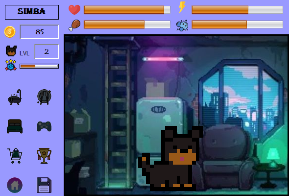
</p>

## Características

- **Hasta 3 partidas** guardadas: puedes crear, continuar o eliminar cada una.
- **Cuatro estados** que cuidar: vida, energía, hambre e higiene.
- **Cinco lugares** para cuidar a tu mascota: cocina, baño, cuarto, tienda y sala de juegos.
- **Minijuego de memoria** para ganar monedas y experiencia.
- **Niveles y logros** que se desbloquean al subir de nivel.
- **Música de fondo** con control de volumen.
- **Guardado en archivos** de texto, manual y automático.

## Capturas

<table>
  <tr>
    <td align="center">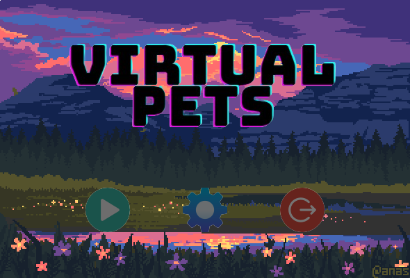<br><b>Menú principal</b></td>
    <td align="center">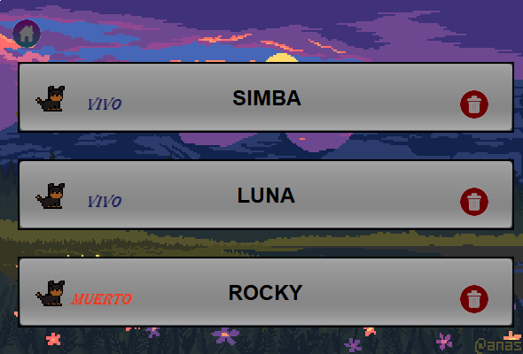<br><b>Selector de partidas</b></td>
  </tr>
  <tr>
    <td align="center">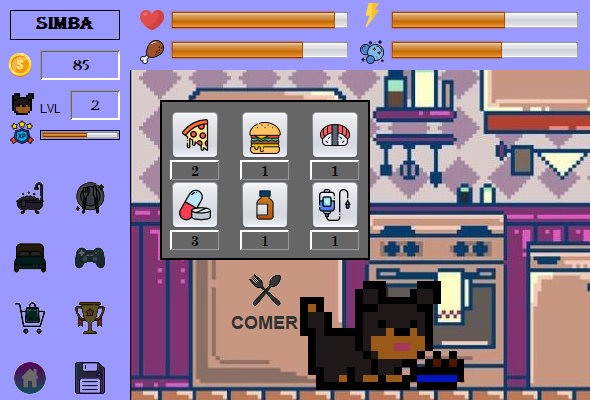<br><b>Cocina</b>: comida y medicinas</td>
    <td align="center">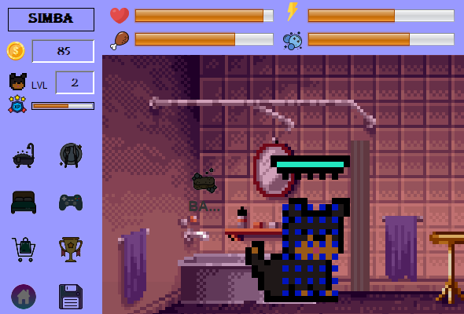<br><b>Baño</b>: recupera higiene</td>
  </tr>
  <tr>
    <td align="center">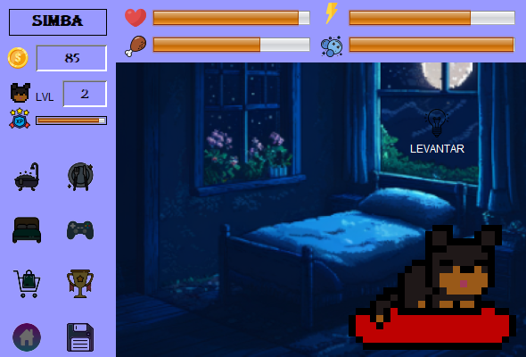<br><b>Cuarto</b>: recupera energía</td>
    <td align="center">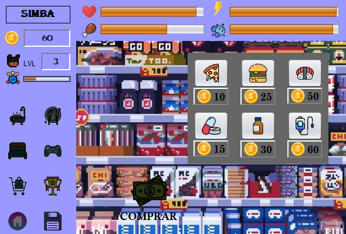<br><b>Tienda</b></td>
  </tr>
  <tr>
    <td align="center">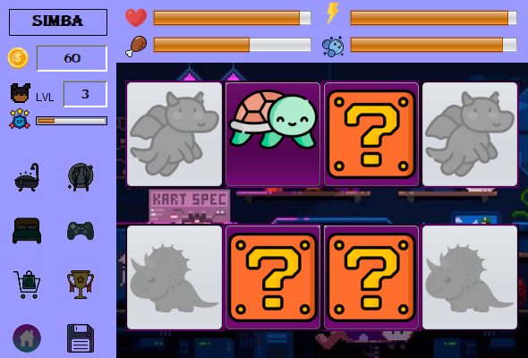<br><b>Juego de memoria</b></td>
    <td align="center">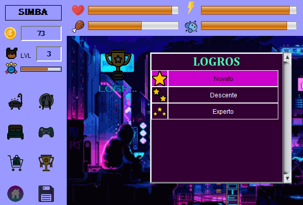<br><b>Logros</b></td>
  </tr>
  <tr>
    <td align="center">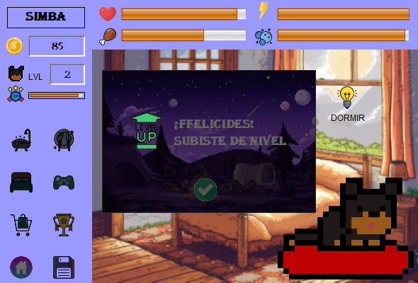<br><b>Subir de nivel</b></td>
    <td align="center">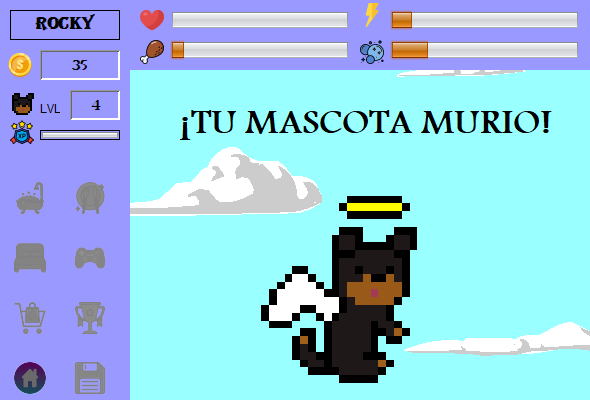<br><b>Si no la cuidas…</b></td>
  </tr>
</table>

## Cómo se juega

Los estados de **energía, hambre e higiene** bajan 1 punto cada 3 segundos. Si cualquiera de ellos cae por debajo de 50, la **vida** empieza a bajar 2 puntos por ciclo. Cuando la vida llega a 0 la mascota muere y la partida queda bloqueada.

| Lugar | Qué haces | Efecto |
|---|---|---|
| Cocina | Dar comida o medicina del inventario | Sube el hambre o la vida |
| Baño | Bañar a la mascota | +6 de higiene por segundo y +6 de experiencia al terminar |
| Cuarto | Apagar la luz para que duerma | +6 de energía por segundo y +10 de experiencia al llenarse |
| Tienda | Comprar comida y medicinas con monedas | Aumenta el inventario |
| Juegos | Juego de memoria con 4 parejas | Entre 10 y 24 monedas y +12 de experiencia al ganar |
| Logros | Ver los logros conseguidos | — |

### Productos

Cada mascota nueva empieza con 3 pizzas, 1 hamburguesa, 1 sushi, 3 pastillas, 1 jarabe y 1 suero.

| Producto | Precio | Efecto | Experiencia |
|---|---|---|---|
| Pizza | 10 | +5 hambre | +4 |
| Hamburguesa | 25 | +15 hambre | +6 |
| Sushi | 50 | +25 hambre | +12 |
| Pastilla | 15 | +5 vida | +7 |
| Jarabe | 30 | +15 vida | +10 |
| Suero | 60 | +25 vida | +20 |

### Niveles y logros

La mascota sube de nivel cuando su experiencia llega a `nivel × 10`.

| Logro | Se consigue al llegar a | Dificultad |
|---|---|---|
| Novato | Nivel 2 | Fácil |
| Descente | Nivel 10 | Media |
| Experto | Nivel 20 | Difícil |

## Requisitos

- **JDK 17 o superior** (probado con JDK 21).
- La librería `AbsoluteLayout.jar`, ya incluida en `dist/lib/`.

## Cómo ejecutarlo

> [!IMPORTANT]
> Ejecuta el juego **desde la raíz del proyecto**. Las partidas, la música y algunas imágenes se leen con rutas relativas (`src/Archivos/…`, `src/Audios/…`), así que desde otra carpeta no las encuentra.

### Opción 1: con el JAR ya compilado

```bash
git clone https://github.com/DavidGR21/MascotaVirtualJAVA.git
cd MascotaVirtualJAVA
java -jar dist/Proyecto_Mascota.jar
```

### Opción 2: desde NetBeans

1. Abre la carpeta con **File → Open Project**.
2. Pulsa **Run** (F6). La clase principal es `Vista.Pantalla_Principal`.

Si NetBeans avisa de que falta `mysql-connector-j-8.0.33.jar`, puedes ignorarlo o quitar esa referencia: es de una versión anterior con base de datos y el juego ya no la usa.

### Opción 3: compilando a mano

Windows (PowerShell):

```powershell
javac -encoding UTF-8 -cp "dist/lib/AbsoluteLayout.jar" -d out (Get-ChildItem -Recurse src -Filter *.java).FullName
java -cp "out;src;dist/lib/AbsoluteLayout.jar" Vista.Pantalla_Principal
```

Linux o macOS:

```bash
javac -encoding UTF-8 -cp dist/lib/AbsoluteLayout.jar -d out $(find src -name "*.java")
java -cp "out:src:dist/lib/AbsoluteLayout.jar" Vista.Pantalla_Principal
```

## Guardado de partidas

Todo se guarda como texto separado por comas en `src/Archivos/`:

| Archivo | Contenido |
|---|---|
| `partidas.txt` | Nombre de cada mascota y si está `vivo` o `muerto` |
| `mascotas.txt` | Nivel, estados, monedas, experiencia e inventario de cada mascota |
| `logros.txt` | Catálogo de logros del juego |
| `logrospormascota.txt` | Logros que ha conseguido cada mascota |

La partida se guarda con el botón del disquete, al volver al menú (si lo confirmas) y de forma automática cada vez que la mascota gana experiencia o compras algo.

## Estructura del proyecto

```
MascotaVirtualJAVA/
├── src/
│   ├── Vista/               Pantallas del juego (menú, salas, tienda, logros, diálogos)
│   ├── Objetos/             Modelo: Mascota, Partida, Logro, Comida, Musica
│   ├── Juegos/              Panel del juego de memoria
│   ├── Juego_Memoria/       Lógica del juego de memoria
│   ├── Archivos/            Archivos de guardado (.txt)
│   ├── Audios/              Música de fondo
│   └── Elementos_Graficos/  Imágenes, iconos y GIFs
├── dist/                    JAR compilado y librerías
├── docs/capturas/           Capturas usadas en este README
├── nbproject/               Configuración del proyecto NetBeans
└── build.xml                Script de Ant generado por NetBeans
```

## Tecnologías

- **Java 17** con **Swing** para la interfaz.
- **NetBeans** (proyecto Ant) y su diseñador de formularios, con `AbsoluteLayout`.
- **Java Sound** (`javax.sound.sampled`) para la música.
- Archivos de texto para la persistencia.

## Autor

[@DavidGR21](https://github.com/DavidGR21)
